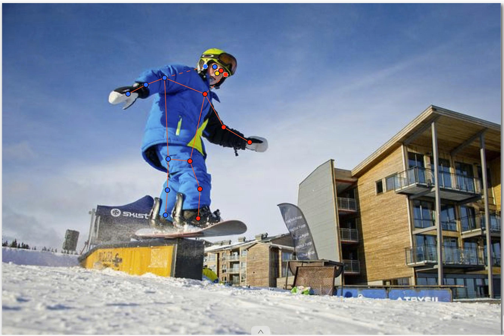
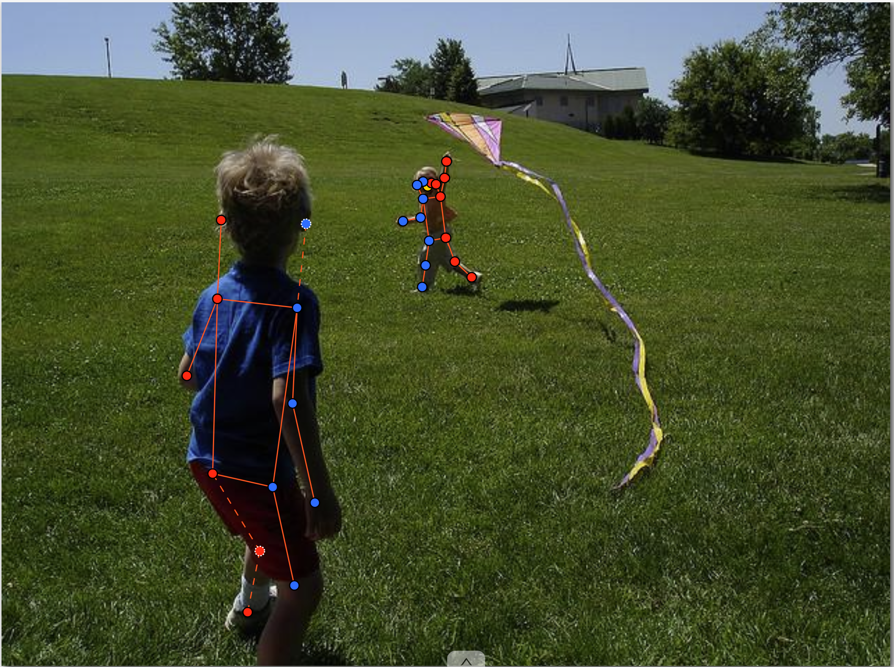
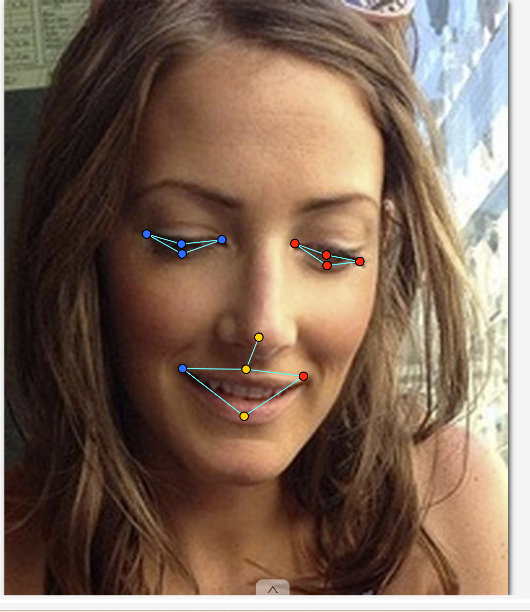
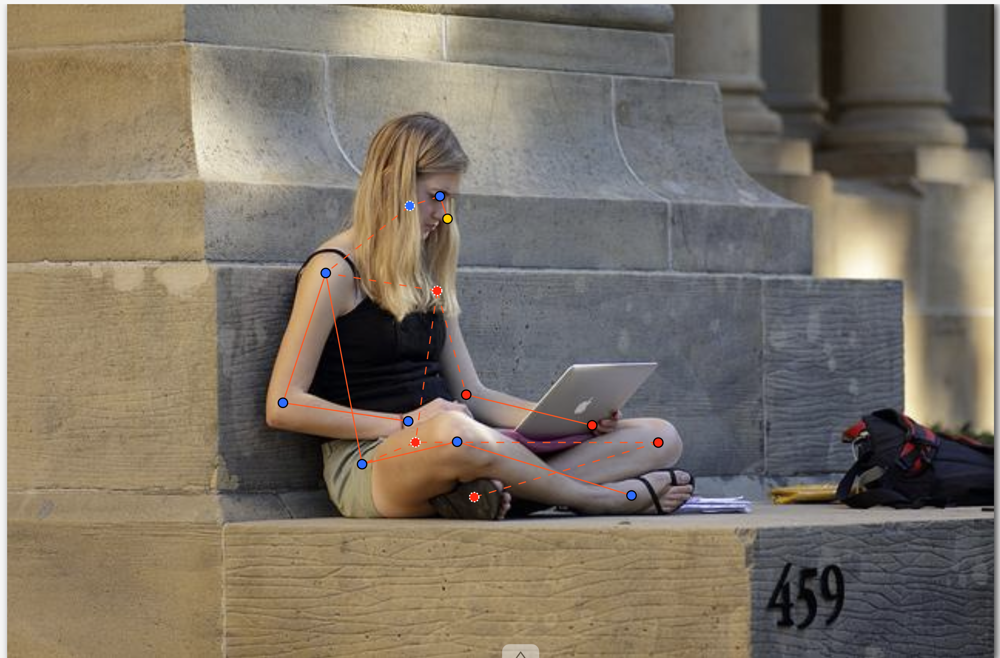

# Báo cáo cá nhân — Đặng Thu Thúy (2A2026603263)

Dữ liệu: 12 ảnh người COCO val2017 và 8 ảnh chân dung Wikimedia Commons, dùng trong lớp.

## 0. Thông tin học viên

- Họ tên: Đặng Thu Thúy
- MSSV: 2A2026603263
- Email: thuythu0965@gmail.com
- Link repository: https://github.com/thuythu0312/K5-L2-DangThuThuy-03263-KeypointPose-Student
- Phiên bản CVAT (Help → About): 2.80.0
- Máy: hệ điều hành  Windows 11 Home, khoảng 32 GB RAM khả dụng· chạy CVAT chế độ đầy đủ
- Bộ ảnh (`src/exports/assignment.json` do `lab.py setup` tạo): có
- Giờ bắt đầu và kết thúc: Chưa ghi nhận.
- MSSV dùng để chọn ảnh trong assignment.json: 03263.

## 1. Kiểm tra label (CP0)

| Label | Kiểu theo lab | Số điểm theo lab | Tên đúng bảng? | Đúng thứ tự? | Số cạnh theo lab |
|---|---|---:|---|---|---:|
| person | Skeleton | 17 | Có | Có | 19 |
| face | Skeleton | 13 | Có | Có | 13 |

Theo mẫu lab, người quay mặt về camera có các điểm left ở bên phải khung mẫu. Để đổi cờ của một điểm, rê chuột lên điểm đó rồi bấm Q cho occluded hoặc O cho outside`

## 2. Số lượng đã gán và thời gian (CP1, CP2)

Số skeleton dưới đây lấy từ nhãn đã lưu trong CVAT.

| Nhóm | Số ảnh | Số skeleton | Người dưới 60 px bỏ qua | Poster / gương / màn hình bỏ qua | Phút |
|---|---:|---:|---|---|---|
| easy | 5 | 5 |  0 quan sát được | 0 | Không ghi |
| occluded | 3 | 6 | 0 quan sát được| 1 | Không ghi |
| back | 2 | 4 | 0 quan sát được | 0 | Không ghi |
| small | 1 | 1 | Chưa xác định | 0 | Không ghi |
| crowd | 1 | 3 | 0 quan sát được | 0 | Không ghi |
| faces | 8 | 8 | — | 0 | Không ghi |

Mốc phút 105, thời lượng CP1–CP3 và ảnh tốn nhiều thời gian nhất: Không ghi thời gian.

## 3. Bảng ca khó (CP1, CP2)

Các cờ dưới đây đã được lưu. Lý do là cách diễn giải theo quy tắc của lab, chưa được học viên xác nhận.

| Ảnh | Người / mặt | Điểm | Cờ đã chọn | Phân vân giữa | Lý do chọn |
|---|---|---|---:|---|---|
| 000000043968.jpg | Người duy nhất | right_ear | 1 | 1 / 0 | Điểm được giữ ở vị trí ước lượng dù không nhìn rõ |
| 000000056651.jpg | Người có gối phải ngoài khung | right_knee | 0 | 1 / 0 | Gối ngoài khung nên bỏ qua điểm khi huấn luyện |
| 000000156986.jpg | Người có cổ tay phải ngoài khung | right_wrist | 0 | 1 / 0 | Cờ đã lưu loại điểm khỏi bộ điểm hợp lệ |

## 4. Bảng tự review (CP3)

Danh sách kiểm theo thứ tự ảnh cuối về ảnh đầu trong từng job. Cột kết quả chờ kiểm trực quan trong CVAT.

| Ảnh | Người / mặt | Điểm cần xem | Mã lỗi | Ghi chú | Đã sửa? |
|---|---|---|---|---|---|
| 000000580257.jpg | Người | Các khớp bị che | — | Kiểm cờ theo từng khớp | 0 |
| 000000461002.jpg | Người | Vai và hông | — | Kiểm trái/phải theo cơ thể | 0 |
| 000000413160.jpg | Người | Cả skeleton | — | Kiểm đối tượng thiếu hoặc thừa | 0 |
| 000000210604.jpg | Người | Vai, hông và mặt | — | Kiểm hướng quay lưng | 0 |
| 000000156986.jpg | Người | Cổ tay và mắt cá | — | Phân biệt bị che và ngoài khung | 0 |
| face_436791.jpg | Mặt | Khóe miệng gần điện thoại | — | Kiểm phần bị che | 0 |
| face_416730.jpg | Mặt | Mí và khóe mắt | — | Kiểm vị trí ở mức phóng to | 0 |
| face_405456.jpg | Mặt | Mí và khóe mắt | — | Kiểm điểm bị che | 0 |

Tổng theo mã `lr_swap`, `vis_flag`, `position`, `missing`, `extra`, `ok`: Chờ review. Dùng `v = 1` nếu điểm bị che nhưng ước lượng được trong ảnh, và `v = 0` nếu điểm ngoài ảnh hoặc không đủ căn cứ để định vị.

## 5. Kiểm file xuất và kết quả tự kiểm (CP4)

| File | Mẫu cần kiểm | Số phần tử kỳ vọng | Cờ và num_keypoints |
|---|---|---:|---|
| DangThuThuy_persons.zip | 000000043968.jpg, người duy nhất | 51 | ZIP hiện tại không có annotation để kiểm tra |
| DangThuThuy_persons.zip | 000000056651.jpg, người có gối phải ngoài khung | 51 | ZIP hiện tại không có annotation để kiểm tra |
| DangThuThuy_faces.zip | face_436791.jpg, mặt duy nhất | 39 | ZIP hiện tại không có annotation để kiểm tra |

Theo tài liệu lab, CVAT xuất `occluded` thành `v = 1` và `outside` thành `v = 0`, đồng thời có thể giữ tọa độ cũ. Hai ZIP hiện tại chứa instances_default.json và không có annotation keypoints, nên chưa kiểm được cờ, tọa độ hay num_keypoints.

Hai job đã completed: Không. Job 12 và 13 đang ở trạng thái `in progress`.

Kết quả chạy check_submission.py: 12 ảnh người, 8 ảnh mặt, 0 skeleton đọc được trong cả hai ZIP, 6 lỗi, 0 cảnh báo. Kết quả CHƯA ĐẠT. Cần xuất lại hai task bằng định dạng COCO Keypoints 1.0.

## 6. Ảnh chụp màn hình

Các vị trí dưới đây chờ ảnh minh chứng:

1. Label person đủ 17 điểm

   
2. Người quay lưng đã gán và đặt cờ

   
3. Mặt đủ 13 điểm, phóng to vùng mắt

   
4. JSON xuất của một người

   

## 7. Tự đánh giá

1. Chưa xác định lỗi thường gặp nhất. Khi review, kiểm hướng của thân người trước, rồi lần theo từng tay và chân để tránh đảo trái/phải.
2. Quy tắc đề xuất: Với điểm bị che, lần theo đoạn chi nhìn thấy đến khớp. Chỉ chọn occluded khi có đủ căn cứ ước lượng vị trí trong khung.
3. Ví dụ ảnh hưởng đến mô hình: Gắn nhầm v = 2 cho khớp ngoài ảnh có thể đưa mục tiêu không hợp lệ vào heatmap hoặc loss. Điểm được đặt v = 0 sẽ được bỏ qua khi tính loss nếu bộ nạp dữ liệu dùng cờ COCO làm mặt nạ.

## 8. Khó khăn và lỗi kỹ thuật

- Kiểm tra ban đầu cảnh báo CVAT có thể kẹt ở Connecting. Script đã thêm cấu hình ghi đè Docker Compose và khởi động lại cvat_server.
- Lần đầu chạy setup gặp HTTP 401 ở bước đăng nhập. Các nhãn hiện đã được lưu trong CVAT.

## Bonus (nếu làm)

Chưa làm

## 9. Tài liệu tham khảo và công cụ AI đã dùng

- Lin và cộng sự (2014), *Microsoft COCO: Common Objects in Context*. Ảnh người từ COCO val2017.
- Wikimedia Commons. Nguồn từng ảnh được ghi trong `src/lab/NGUON_ANH.md`.
- Tài liệu lab: `docs/GUIDELINE.md`, `docs/COCO_KEYPOINTS.md`, `docs/CVAT_CHEATSHEET.md`.
- Codex hỗ trợ gán điểm và tổng hợp báo cáo từ dữ liệu CVAT.
